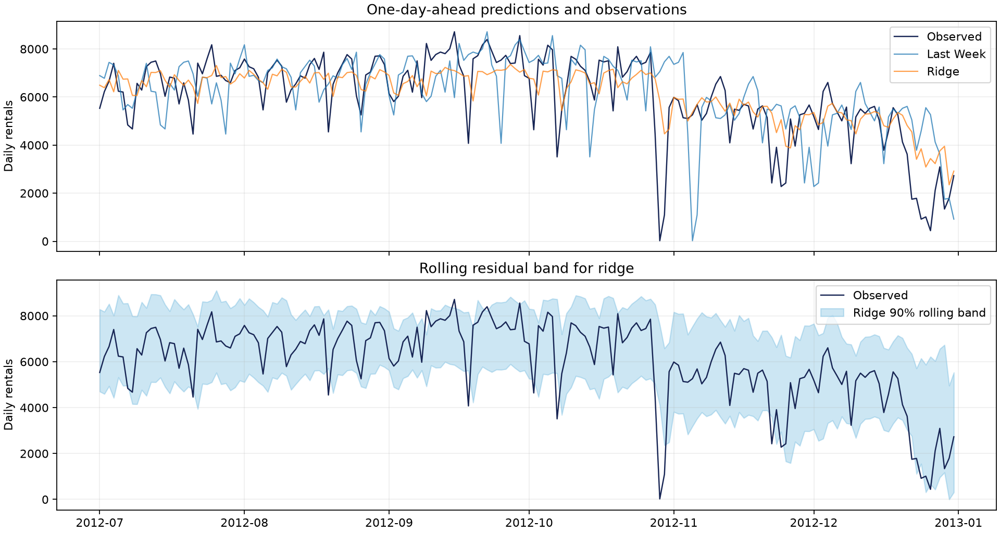

# BikeShare Walk-Forward

How well can tomorrow's Capital Bikeshare demand be forecast from information available at the end of today? This reproducible benchmark compares two naive forecasts, ridge regression, and histogram gradient boosting on daily rentals.



## Reproduce

Use Python 3.13. The daily data is included. After installing dependencies, the project runs offline.

```sh
python -m pip install -r requirements.txt
python -m unittest -v
python forecast.py
```

## Backtest design

- Forecast one day ahead. The prior day's final rental count is assumed to be available at forecast time.
- Start rolling predictions on January 1, 2012. Refit each learned model every 14 days on expanding history, using only labels before the current refit. Score the 184 days from July 1 to December 31. Earlier 2012 predictions supply residual history for the initial intervals.
- Predictors use known calendar values and strictly lagged counts. The models exclude realized weather, same-day rental components, and the same-day total.
- Construct rolling 90% target bands from the previous 60 absolute forecast errors. The reported coverage is empirical. Seasonal shifts and time dependence can invalidate exchangeability, so the bands carry no finite-sample coverage guarantee.

## Results

Errors and interval widths are in rentals. Per-day outputs are in [predictions.csv](results/predictions.csv) and aggregate metrics are in [metrics.json](results/metrics.json).

| Forecast | MAE | RMSE | Coverage | Mean band width |
| --- | ---: | ---: | ---: | ---: |
| Yesterday | 840.1 | 1,219.0 | 90.8% | 4,208 |
| Same day last week | 1,129.8 | 1,648.4 | 88.6% | 4,888 |
| Ridge | 791.6 | 1,141.4 | 88.6% | 3,522 |
| Gradient boosting | 908.6 | 1,300.1 | 89.1% | 3,924 |

Ridge reduced MAE by 5.8% compared with yesterday's count. Gradient boosting underperformed that baseline on this period. The test covers six months in one city and assumes stable access to yesterday's final count. It does not evaluate a multi-day forecast or measure the value of weather forecasts.

## Data

The original `day.csv` comes from Hadi Fanaee-T and João Gama's [Bike Sharing dataset](https://doi.org/10.24432/C5W894), distributed through the UCI Machine Learning Repository under [CC BY 4.0](https://creativecommons.org/licenses/by/4.0/). The checked-in file is unchanged and has SHA-256 `a6bcf826782d3c0fbfdcbeead17cd0884185a0dafe8ff10cd48a874ee7ba18be`.
